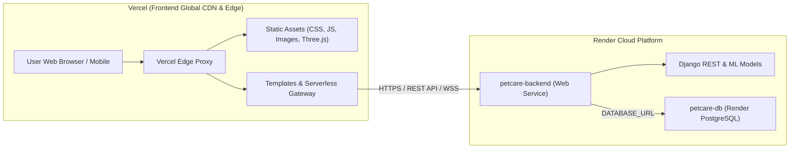

# Deploying Pet Care Companion: Render (Backend & Database) + Vercel (Frontend)

This guide provides step-by-step instructions for deploying the **Pet Care Companion** platform in a modern decoupled cloud architecture:
- **Render:** Hosts the Python/Django **Backend Application** and managed **PostgreSQL Database**.
- **Vercel:** Hosts the **Frontend** presentation layer (static assets, responsive templates, client JavaScript, and edge proxy).

---

## 🏗️ Architecture Overview



---

## Part 1: Deploying Backend & Database on Render

Render manages both the PostgreSQL database and the Django web service using the included `render.yaml` blueprint.

### Step 1: Push Project to GitHub / GitLab
Make sure your repository contains the root files:
- `render.yaml`
- `build.sh`
- `backend/`
- `database/`
- `requirements.txt`

### Step 2: Create Render Blueprint (1-Click Setup)
1. Log in to [Render Dashboard](https://dashboard.render.com).
2. Click **New +** in the top navigation bar and select **Blueprint**.
3. Connect your Git repository.
4. Render will read `render.yaml` and display two components to create:
   - **`petcare-db`**: Render Managed PostgreSQL Database (Free tier).
   - **`petcare-backend`**: Python Web Service running Gunicorn (Free tier).
5. Click **Apply**.
6. Render will automatically:
   - Provision the PostgreSQL database.
   - Inject `DATABASE_URL` directly into the web service.
   - Run `build.sh` to install dependencies, collect static files, and execute database migrations.
   - Start the web service with `gunicorn config.wsgi:application`.

### Step 3: Verify Backend & Database Health
Once deployment completes, open your Render web service URL:
```bash
https://petcare-backend-xxxx.onrender.com/api/health-check/
```

You should receive a `200 OK` JSON response:
```json
{
  "status": "healthy",
  "service": "Pet Care Companion Backend",
  "database": {
    "status": "connected",
    "engine": "postgresql"
  },
  "timestamp": "2026-10-19T08:54:40.795264+00:00",
  "cors_enabled": true,
  "hosting": "Render"
}
```

### Step 4: Create Django Admin Superuser (Optional)
In your Render web service dashboard:
1. Open the **Shell** tab.
2. Run:
   ```bash
   python manage.py createsuperuser
   ```
3. Enter your desired admin username, email, and password.

---

## Part 2: Deploying Frontend on Vercel

The `frontend/` directory contains all responsive templates, UI components, static styling, client-side scripts, and `vercel.json`.

### Option A: Deploying from Vercel Web Dashboard (Recommended)

1. Log in to [Vercel](https://vercel.com) and click **Add New...** -> **Project**.
2. Select your Git repository.
3. In the **Configure Project** screen:
   - **Framework Preset:** Leave as *Other*.
   - **Root Directory:** Click *Edit* and select `frontend` (or leave as root `/`).
4. In **Environment Variables**, optionally set:
   - `RENDER_BACKEND_URL`: `https://petcare-backend-xxxx.onrender.com` (your Render URL from Part 1).
5. Click **Deploy**.
6. Vercel will build and deploy your frontend to a global edge CDN URL (e.g., `https://pet-care-companion.vercel.app`).

### Option B: Deploying via Vercel CLI

If you have the Vercel CLI installed:
```bash
# Navigate to frontend directory
cd frontend

# Deploy to Vercel preview
vercel

# Deploy to production
vercel --prod
```

---

## Part 3: Connecting Vercel Frontend to Render Backend

### 1. Edge Proxy Rewrites (`vercel.json`)
The included `frontend/vercel.json` automatically routes:
- `/static/*` ➔ Served with edge caching from Vercel's global CDN.
- Dynamic requests (`/api/*`, `/users/*`, `/bookings/*`, `/chatbot/*`, etc.) ➔ Handled by Vercel Serverless Function or proxied to the Render backend.

If you wish to route all dynamic traffic directly to your Render backend domain via Vercel's Edge network, update the rewrites in `frontend/vercel.json`:
```json
{
  "version": 2,
  "rewrites": [
    {
      "source": "/static/(.*)",
      "destination": "/static/$1"
    },
    {
      "source": "/(.*)",
      "destination": "https://YOUR-RENDER-BACKEND.onrender.com/$1"
    }
  ]
}
```

### 2. Client-side Configuration (`api_config.js`)
The file `frontend/static/js/api_config.js` is automatically loaded on all pages. It detects whether the site is running on Vercel (`*.vercel.app`), Render (`*.onrender.com`), or local development, ensuring all AJAX calls (such as UPI QR payment polling and the AI Chatbot) communicate smoothly.

### 3. Pre-configured CORS & CSRF
The Django backend (`backend/config/settings.py`) is already configured with:
- `CORS_ALLOW_ALL_ORIGINS = True`
- `CORS_ALLOWED_ORIGIN_REGEXES = [ r"^https:\/\/.*\.vercel\.app$", r"^https:\/\/.*\.onrender.com$" ]`
- `CSRF_TRUSTED_ORIGINS = [ 'https://*.vercel.app', 'https://*.onrender.com' ]`

This guarantees that login sessions, forms, and real-time payment verifications work seamlessly across Vercel and Render without cross-origin blocks.

---

## Part 4: Local Development & Fallbacks

Even with Render and Vercel configurations in place, local development remains 100% operational with zero setup:
```bash
# Run local Django server (uses database/db.sqlite3 by default)
python manage.py runserver

# Run system verification tests
python manage.py test tests_system.PetCareCompanionSystemTest
```
